# Linux Server Lab: Ubuntu Server, Apache, SSH Hardening and Monitoring

A weekend project in which I built and hardened an Ubuntu Server VM, ran Apache as a service, managed users and permissions, and used `top`, `journalctl` and `systemctl` to monitor and troubleshoot it under load.

**Author:** `Vedant R. Dhajekar` | **GitHub:** `vdhajekar-pixel!`

## Summary

| Area | What I did |
|---|---|
| Platform | Ubuntu Server 24.04.5 LTS in VMware Workstation (2 vCPU, 2 GB RAM, 12 GB disk, NAT, LVM) |
| Users and permissions | Users and a group, setgid shared directory, ACLs, a limited sudo rule, password aging and account locking |
| SSH hardening | Key-only login, root login disabled, `AllowUsers` allow-list, `MaxAuthTries 3`, UFW firewall |
| Service | Apache 2.4 with a custom virtual host, files managed by a group |
| Monitoring | `top`, `free`, `df`, `vmstat`, `systemctl`, `journalctl`, `systemd-analyze`; load generated with `stress-ng` and `ab` |
| Troubleshooting | Broke the Apache config on purpose, diagnosed it from the logs, fixed it; killed Apache and verified automatic recovery |

## Contents

1. [Environment](#1-environment)
2. [VM installation](#2-vm-installation)
3. [Users, groups and permissions](#3-users-groups-and-permissions)
4. [SSH hardening and firewall](#4-ssh-hardening-and-firewall)
5. [Apache web server](#5-apache-web-server)
6. [Monitoring and performance](#6-monitoring-and-performance)
7. [Break and fix](#7-break-and-fix)
8. [What broke and how I fixed it](#8-what-broke-and-how-i-fixed-it)
9. [Lessons learned](#9-lessons-learned)
10. [Repository layout](#10-repository-layout)

---

## 1. Environment

| Item | Value |
|---|---|
| Host | Windows laptop, VMware Workstation |
| Guest OS | Ubuntu Server 24.04.5 LTS (kernel 6.8, amd64) |
| Resources | 2 vCPUs, 2 GB RAM, 12 GB dynamically allocated disk |
| Network | NAT, guest IP `192.168.79.148` on `ens33` |
| Hostname | `lab-server` |
| Admin account | `vedant` (sudo) |
| Test accounts | `alice` (member of `webteam`), `bob` (not a member) |

I used a 12 GB dynamic disk because the host had limited free space. The ISO was deleted after installation.

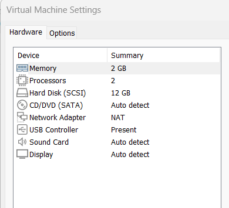
*Figure 1: VMware hardware configuration.*

## 2. VM installation

I installed from the official Ubuntu Server ISO with the guided LVM layout: `/` is a 10 GB logical volume and `/boot` is 1.75 GB. I enabled the OpenSSH server in the installer and skipped the optional snaps.

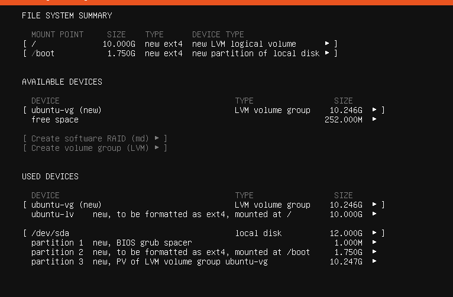

*Figure 2: Guided LVM storage summary.*

After the first boot I logged in at the console and noted the IP address.

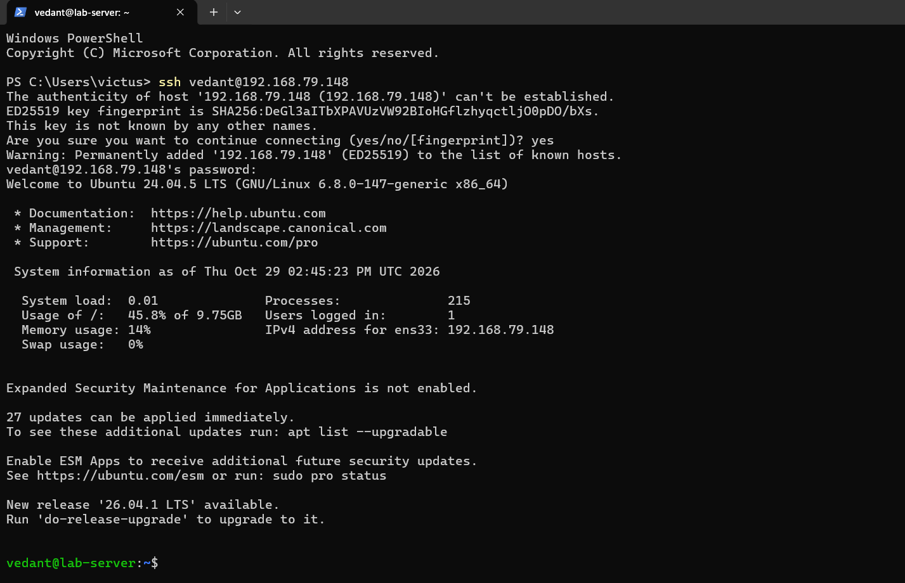
*Figure 3: First login showing Ubuntu 24.04.5 LTS and the IPv4 address.*

From then on I worked over SSH from PowerShell on the host, and updated the system:

```bash
sudo apt update && sudo apt upgrade -y && sudo apt clean
lsb_release -a
uname -r
```

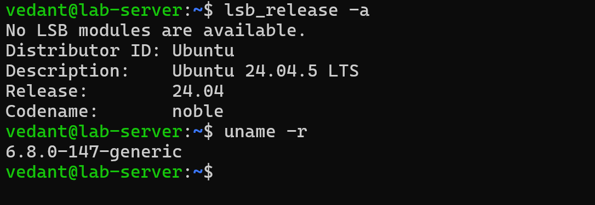
*Figure 4: Remote SSH session with `lsb_release -a` and `uname -r`.*

I took a VMware snapshot (`clean-install`) so I could roll back if hardening went wrong.

## 3. Users, groups and permissions

### 3.1 Users, group and a shared directory

```bash
sudo adduser alice
sudo adduser bob
sudo groupadd webteam
sudo usermod -aG webteam alice          # bob is left out on purpose

sudo mkdir -p /srv/projects
sudo chown root:webteam /srv/projects
sudo chmod 2770 /srv/projects
ls -ld /srv/projects                    # drwxrws---
```

The mode `2770` gives the owner and group full access and everyone else none. The leading `2` is the **setgid bit**: files created inside the directory inherit the `webteam` group instead of the creator's primary group, so team members can always work on each other's files.

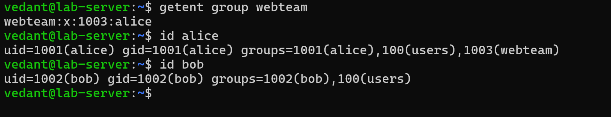
*Figure 5: `getent group webteam`, `id alice`, `id bob` and the directory mode.*

### 3.2 Testing access control

```bash
sudo -u alice touch /srv/projects/alice-was-here.txt
sudo -u alice ls -l /srv/projects       # file group is webteam (setgid works)
sudo -u bob ls /srv/projects            # Permission denied
```

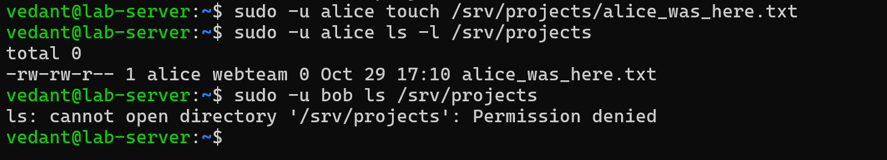
*Figure 6: Alice can read and write; bob is denied.*

### 3.3 ACLs

Ubuntu Server's minimal image does not include the ACL tools, so I installed them first. I then gave bob read-only access without adding him to the group:

```bash
sudo apt install -y acl
sudo setfacl -m u:bob:r-x /srv/projects
getfacl /srv/projects
sudo -u bob ls /srv/projects                     # now works
sudo -u bob touch /srv/projects/bob-test.txt     # still Permission denied
```

A POSIX ACL grants access to one extra user without changing group membership. `ls -ld` now shows a `+` after the permission string to indicate that an ACL is present.

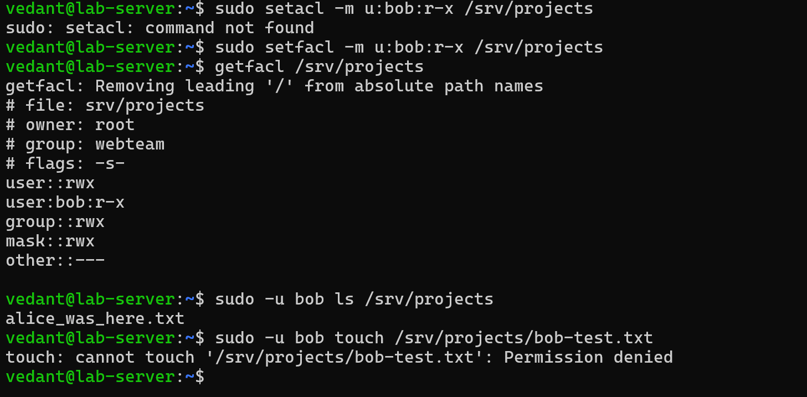
*Figure 7: ACL entry for bob, read succeeds, write denied.*

### 3.4 Limited sudo for alice

Created with `sudo visudo -f /etc/sudoers.d/alice`, which validates syntax before saving:

```
alice ALL=(root) /usr/bin/systemctl restart apache2, /usr/bin/systemctl status apache2
```

```bash
sudo cat /etc/sudoers.d/alice
sudo -l -U alice
su - alice
sudo systemctl status apache2     # allowed
sudo apt update                   # refused
```

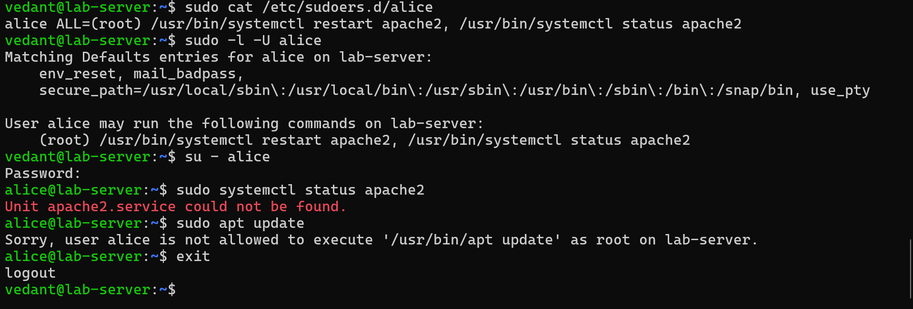
*Figure 8: Alice may run only the two permitted commands; `apt update` is refused.*

### 3.5 Password aging and account locking

```bash
sudo chage -M 90 -W 7 alice       # expire every 90 days, warn 7 days before
sudo chage -l alice
sudo passwd -l bob                # lock bob's password
sudo passwd -S bob                # status field shows L
```

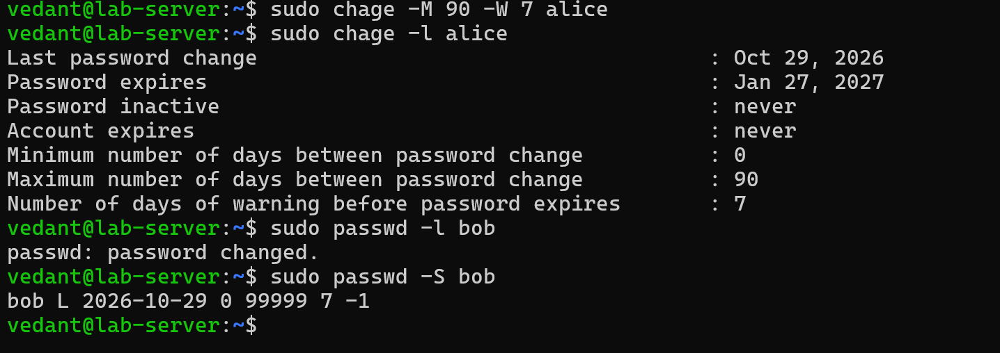
*Figure 9: Alice's aging policy and bob's locked account.*

## 4. SSH hardening and firewall

I set up key authentication first, confirmed it worked, and only then disabled passwords.

### 4.1 Key-based login

On the Windows host:

```powershell
ssh-keygen -t ed25519
type $env:USERPROFILE\.ssh\id_ed25519.pub | ssh alice@192.168.79.148 "mkdir -p ~/.ssh && chmod 700 ~/.ssh && cat >> ~/.ssh/authorized_keys && chmod 600 ~/.ssh/authorized_keys"
```

I repeated the install for `vedant` so I kept remote admin access. Windows has no `ssh-copy-id`, so the public key is piped over SSH.

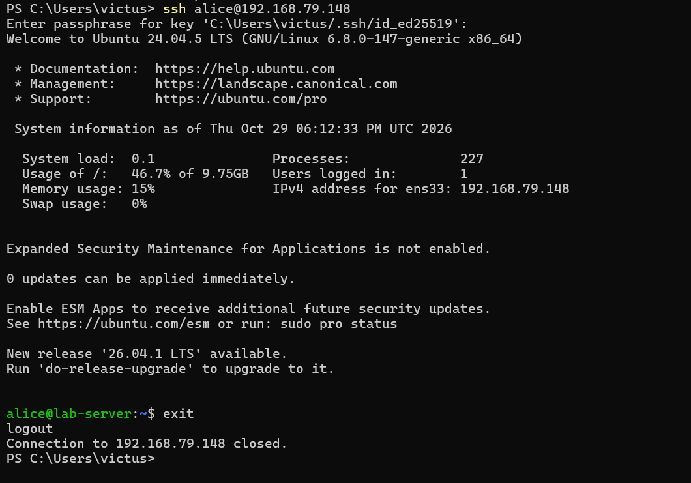
*Figure 11: Logging in as alice with the key, no account password.*

### 4.2 Hardening configuration

File: `/etc/ssh/sshd_config.d/01-hardening.conf`

```
PermitRootLogin no
PasswordAuthentication no
AllowUsers alice vedant
MaxAuthTries 3
```

The `01-` prefix matters: sshd uses the first value it reads for each setting, in alphabetical file order, so this file must sort before any cloud-init file that might re-enable passwords.

```bash
sudo sshd -t                                       # syntax check, no output means valid
sudo sshd -T | grep -Ei 'passwordauthentication|permitrootlogin|allowusers|maxauthtries'
sudo systemctl reload ssh
```

I kept my existing session open and tested a new login in a second window before closing anything, to avoid locking myself out.

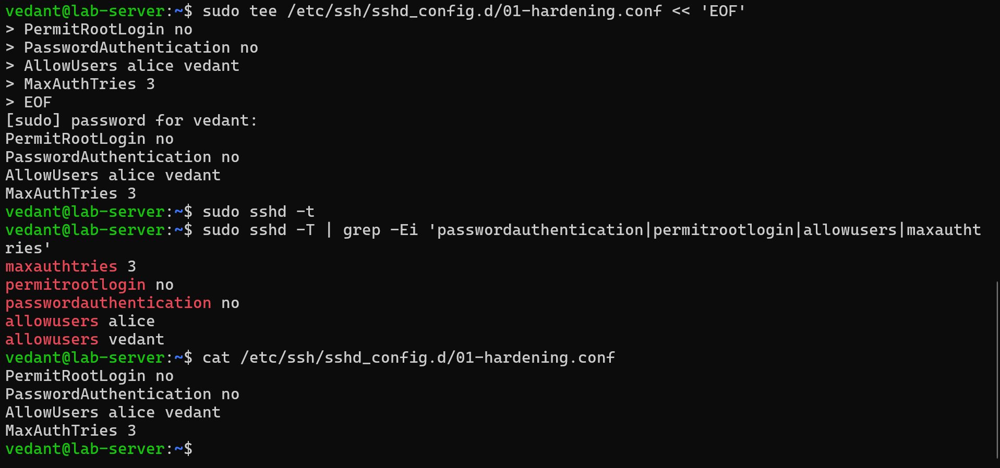
*Figure 10: Hardening file and the effective sshd settings.*

### 4.3 Rejected login

```powershell
ssh bob@192.168.79.148     # Permission denied (publickey)
```

```bash
sudo journalctl -u ssh --since "15 min ago" --no-pager | grep -i bob
```

The client only sees `Permission denied (publickey)`. The server log gives the real reason: bob is not listed in `AllowUsers`, and the connection is dropped before authentication.

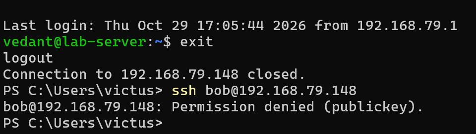
*Figure 12a: Bob's login rejected from PowerShell (`Permission denied (punlic key)`).*

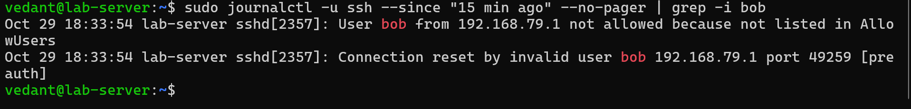
*Figure 12b: The journal shows bob is not listed in `AllowUsers`.*

### 4.4 Firewall

```bash
sudo ufw allow OpenSSH      # added before enabling, so the session survives
sudo ufw enable
sudo ufw status verbose
```

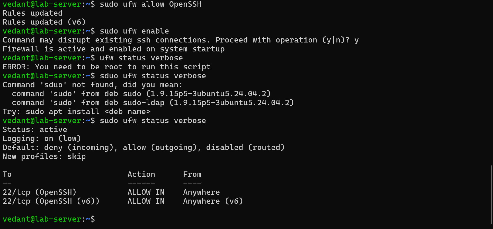
*Figure 13: UFW active, default deny incoming.*

## 5. Apache web server

```bash
sudo apt install -y apache2
sudo ufw allow 'Apache'
systemctl status apache2 --no-pager
```

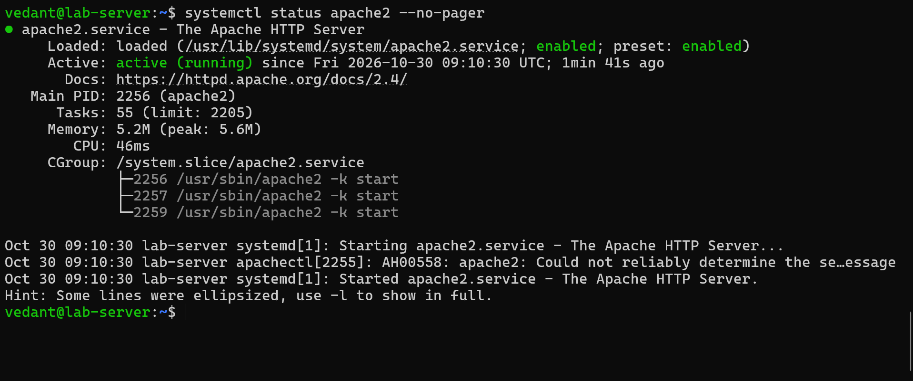
*Figure 14: `apache2` active (running).*

### Virtual host

The site files belong to `alice:webteam` with mode `2775`, so the team can edit them and Apache's `www-data` user can read them.

```bash
sudo mkdir -p /var/www/mysite
sudo chown -R alice:webteam /var/www/mysite
sudo chmod 2775 /var/www/mysite
```

`/etc/apache2/sites-available/mysite.conf`:

```apache
<VirtualHost *:80>
    ServerName lab-server
    DocumentRoot /var/www/mysite
    ErrorLog ${APACHE_LOG_DIR}/mysite-error.log
    CustomLog ${APACHE_LOG_DIR}/mysite-access.log combined
</VirtualHost>
```

I validated the config before reloading, so a mistake can't take the site down:

```bash
sudo a2dissite 000-default
sudo a2ensite mysite
sudo apache2ctl configtest      # Syntax OK
sudo systemctl reload apache2
curl http://localhost
```

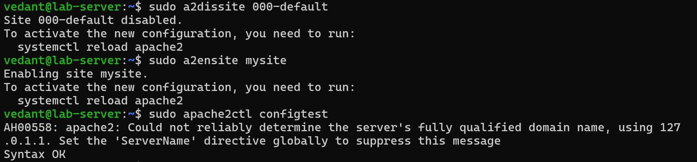
*Figure 16a: Default site disabled, `mysite` enabled  and `configtest` reports Syntax OK.*

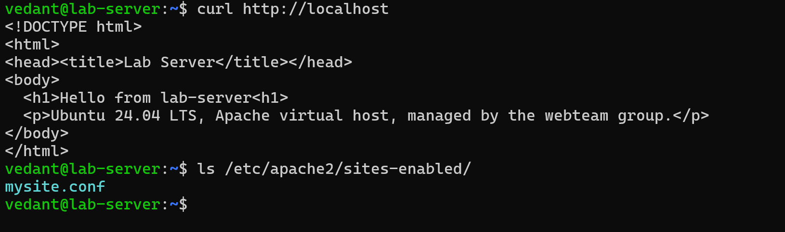
*Figure 16b: `curl` returns the page and `sites-enabled` lists only `mysite.conf`.*

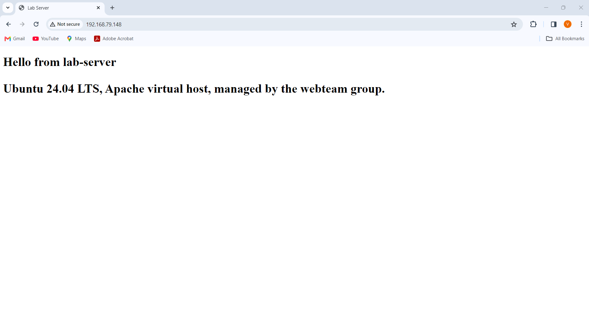
*Figure 15: The site served to the host browser at the VM's IP.*

## 6. Monitoring and performance

### 6.1 Idle baseline

```bash
top            # press 1 for per-core view
free -h
df -h /
vmstat 1 5
```

| Metric | Idle value |
|---|---|
| Load average (1, 5, 15 min) | 0.05, 0.02, 0.00 |
| CPU idle | 99.2% |
| Memory used | 389.6 MiB of 1919.8 MiB |
| Swap used | 0 |

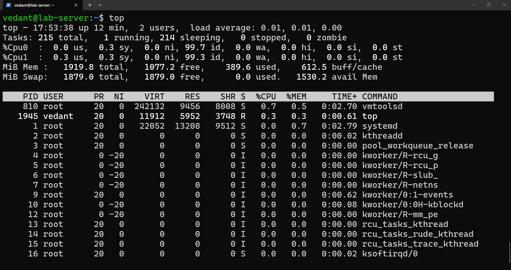
*Figure 17: `top` at idle.*

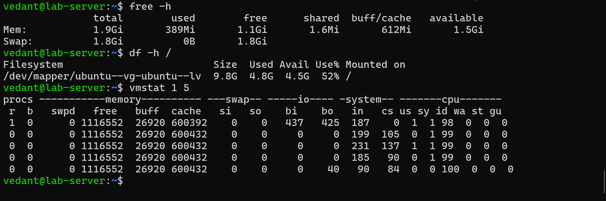
*Figure 19: `free -h`, `df -h /` and `vmstat`.*

### 6.2 CPU load with stress-ng

```bash
stress-ng --cpu 2 --timeout 60s
```

Run in one terminal while watching `top` in another. Both cores went to full use and the `stress-ng` workers appeared at the top of the process list. The 1-minute load average rose from 0.05 to **1.27** during the 60-second run. Load average is a moving average, so it climbs toward the number of busy workers (2) gradually rather than instantly.

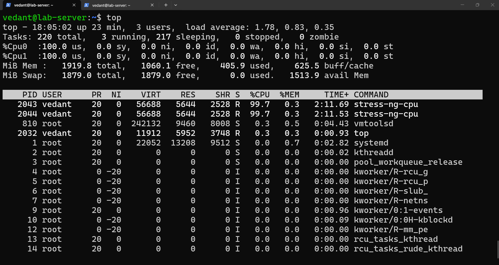
*Figure 18: `top` during `stress-ng`.*

### 6.3 Web load with ApacheBench

```bash
ab -n 50000 -c 50 http://localhost/
```

| Metric | Result |
|---|---|
| Requests completed / failed | 50,000 / 0 |
| Time taken | 3.284 s |
| Requests per second | about 15,200 |
| Latency | median 3 ms, max 48 ms |
| Transfer rate | about 6.9 MB/s |

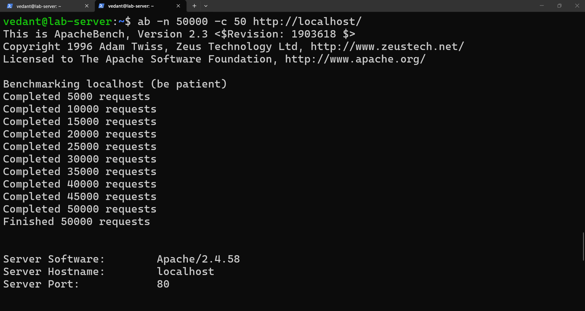
*Figure 20a: `ab -n 50000 -c 50 http://localhost/` against Apache 2.4.58 on port 80.*

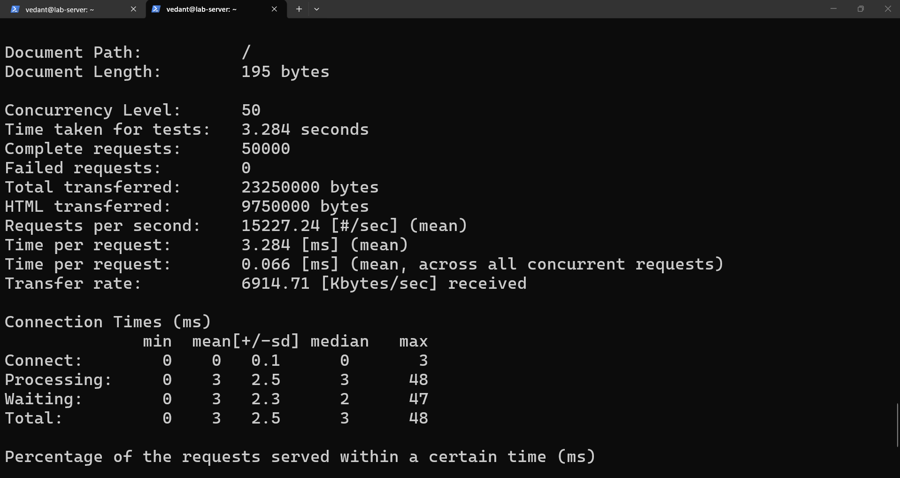
*Figure 20b: 50,000 requests completed with 0 failed, at about 15,227 requests/s over 3.284 s. Median total time was 3 ms and the maximum was 48 ms.*

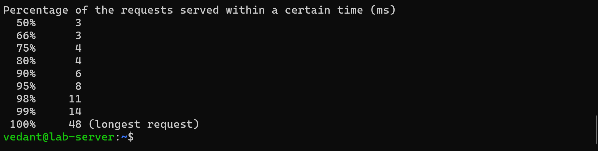
*Figure 20c: Latency percentiles: 50% of requests finished within 3 ms, 95% within 8 ms, and 99% within 14 ms. The slowest request took 48 ms.* 

During the test, `top` showed `ab` and four `apache2` workers (user `www-data`) sharing the CPU. Load average reached **2.27, 0.84, 0.47** on the 2-core VM. Kernel time (`sy`, about 45%) exceeded user time (`us`, 19 to 32%), which is expected when serving tiny static files, because most of the work is network and socket handling in the kernel. Memory rose by about 40 MiB and swap stayed at zero, so the workload was CPU-bound rather than memory-bound.

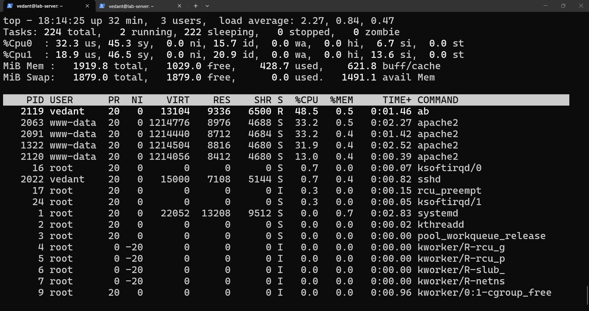
*Figure 21: `top` during the Apache load test.*

The access log shows the same burst, with timestamps that match the spike:

```bash
sudo tail -5 /var/log/apache2/mysite-access.log
```

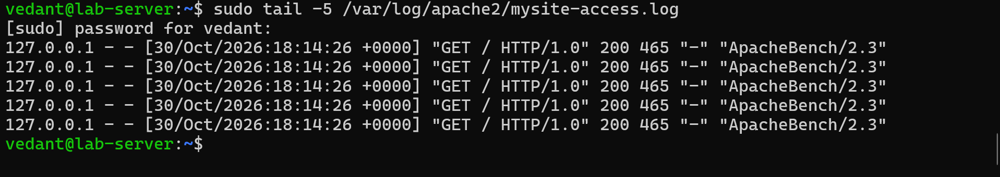
*Figure 22: Access log entries from `ApacheBench/2.3`.*

**Caveat:** `ab` ran on the same VM as Apache over `localhost`, so the two competed for the same two CPUs and no real network latency was involved. These numbers describe how the server behaves under load, not what a remote client would see.

### 6.4 systemctl and journalctl

```bash
systemctl list-units --failed
systemd-analyze blame | head
sudo journalctl -u apache2 --since today --no-pager | tail -20
sudo journalctl -p err -b --no-pager | tail
```

No units had failed. The slowest startup item was `apt-daily.service` at about 9.1 s; several services start in parallel, so the individual times do not add up to total boot time.

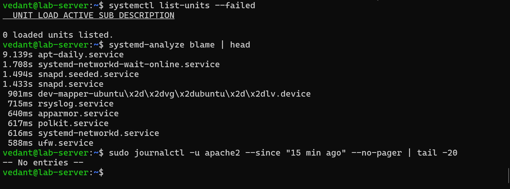
*Figure 23a: No failed units, total boot time and the slowest startup services.*

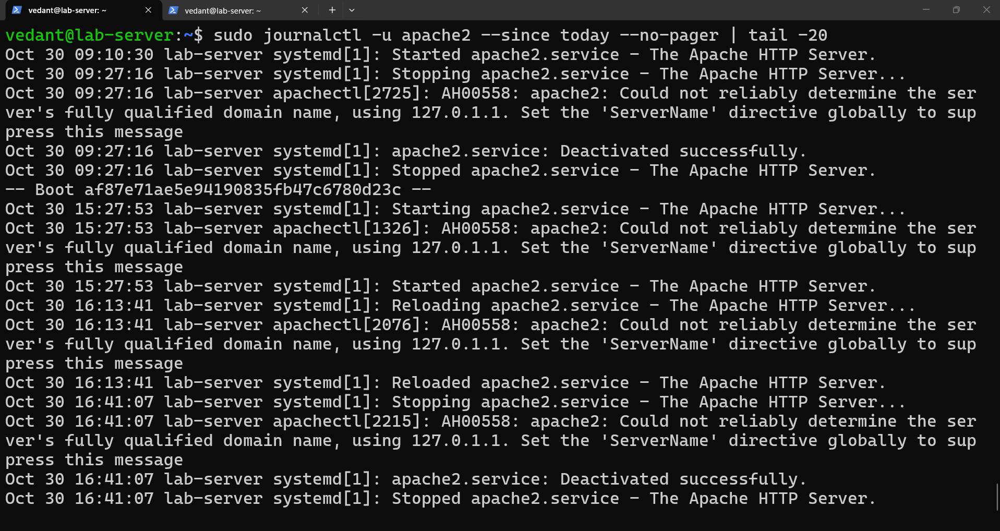
*Figure 23b: Apache start, reload and restart entries in the journal.*

## 7. Break and fix

### 7.1 Broken Apache configuration

I introduced a typo (`DocumentRoot` became `DocumentRoo`) and tried to apply it:

```bash
sudo sed -i 's/DocumentRoot/DocumentRoo/' /etc/apache2/sites-available/mysite.conf
sudo apache2ctl configtest
sudo systemctl reload apache2
curl http://localhost
```

`configtest` reported `AH00526: Syntax error on line 3 ... Invalid command 'DocumentRoo'`. The reload was refused, and `curl` still returned the page, because Apache keeps running its old configuration when a reload fails. This is why `configtest` comes before every reload.

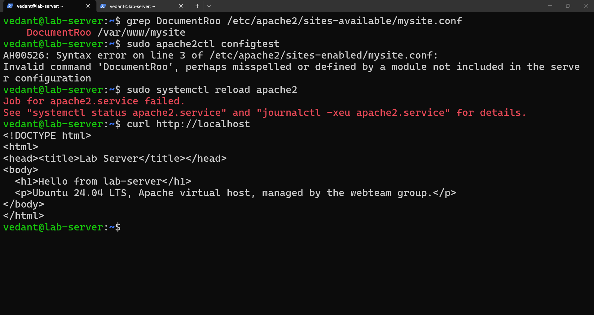
*Figure 24: Typo in the file, `configtest` reports error, and the `curl` still serving the site.*

```bash
systemctl status apache2 --no-pager
sudo journalctl -xeu apache2 --no-pager | tail -20
```

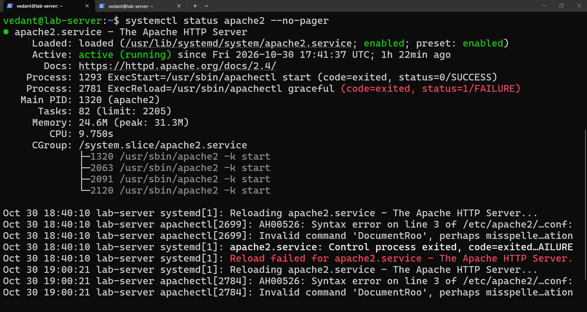
*Figure 25a: Apache is still active (running) with the same main PID, but `ExecReload` failed with status 1 and the log shows the syntax error on line 3.*

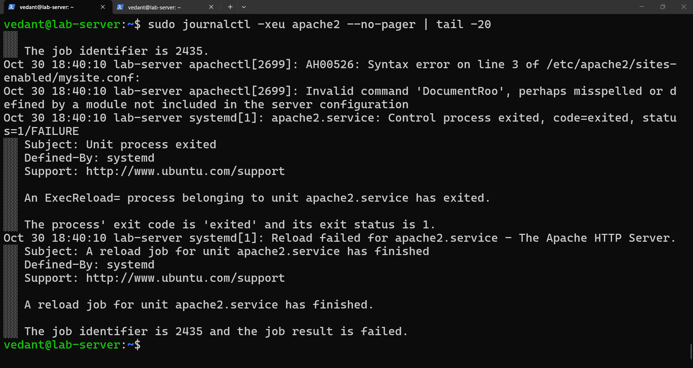
*Figure 25b: `journalctl -xeu apache2` shows `Invalid command 'DocumentRoo'` and that the reload job failed.*

I fixed the line, confirmed `Syntax OK`, and reloaded:

```bash
sudo sed -i 's/DocumentRoo /DocumentRoot /' /etc/apache2/sites-available/mysite.conf
sudo apache2ctl configtest
sudo systemctl reload apache2
```

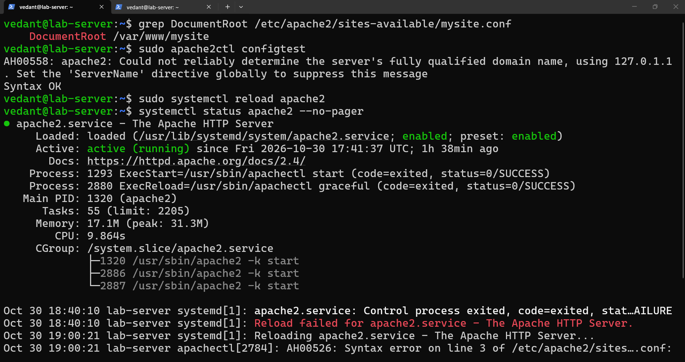
*Figure 26a: `DocumentRoot` restored, `configtest` reports Syntax OK, reload succeeds and Apache is active (running).*

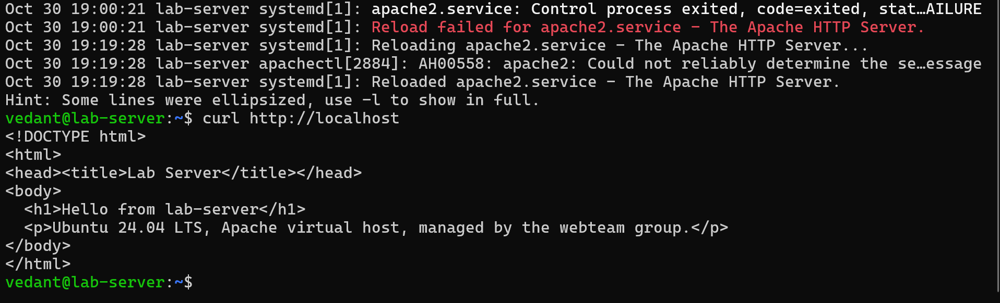
*Figure 26b: The journal shows the earlier failed reload (19:00:21) followed by the successful reload (19:19:28), and `curl` returns the corrected page.* 

### 7.2 Crash and automatic recovery

I killed Apache's main process with `SIGKILL` and watched systemd bring it back:

```bash
sudo kill -9 $(systemctl show -p MainPID --value apache2)
```

Ubuntu's packaged unit already sets `Restart=on-abort`, which restarts a process killed by a signal. I tightened this with a drop-in override so Apache also restarts after a non-zero exit code. `/etc/systemd/system/apache2.service.d/override.conf`:

```ini
[Service]
Restart=on-failure
RestartSec=2
```

```bash
sudo systemctl daemon-reload
sudo systemctl restart apache2
systemctl show apache2 -p Restart -p RestartUSec     # on-failure, 2s
```

After the kill the main PID changed from 2888 to 2964, the status was **active (running)** with a fresh start time, the journal logged `Scheduled restart job, restart counter is at 1`, and `curl -I` returned `HTTP/1.1 200 OK`.

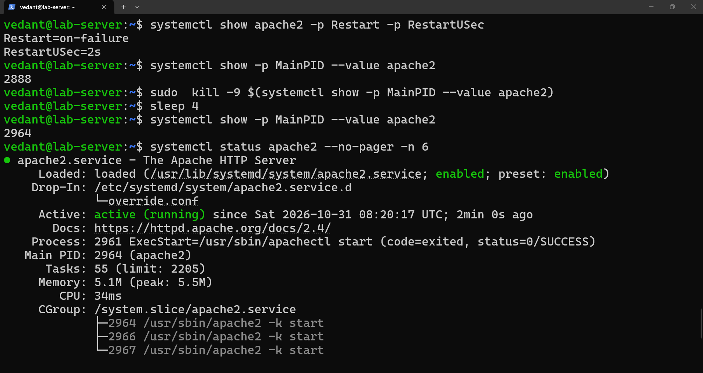
*Figure 27a: Effective restart policy, PID change, active status and the drop-in file.*

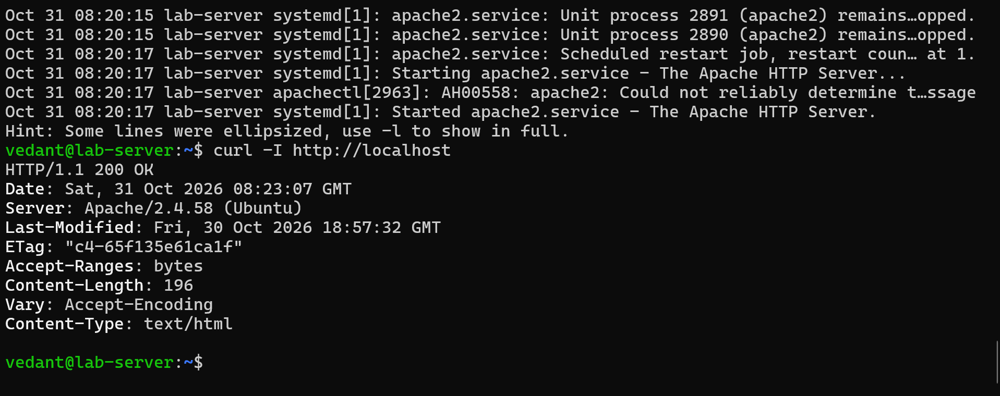
*Figure 27b: Restart entries in the journal and a successful HTTP response.*


## 8. What broke and how I fixed it

| Problem | Cause | Fix |
|---|---|---|
| `getnet: command not found` | Typo for `getent` | Retyped the command |
| `chown` and `cp` returned "Operation not permitted" / "Permission denied" | Ran them without `sudo`; ownership changes and `/root` need root | Re-ran with `sudo` |
| `setfacl: command not found` | The `acl` package is not in the minimal server image | `sudo apt install acl` |
| Heredoc kept showing `>` prompts and wrote bad HTML | The closing `EOF` line was not recognised after pasting, and the closing tags were mistyped | Cancelled with Ctrl+C and wrote files with `printf \| sudo tee`; fixed `<h1>` closing tag later |
| `ls /etc/apache2/...` said path not found | I was typing at the Windows PowerShell prompt, not in the VM | Reconnected over SSH; the prompt must read `vedant@lab-server` |
| `top` output stacked repeatedly | Terminal window too small for the redraw | Maximised the window and re-ran `top` |
| Restore from backup still had the typo | The backup was taken **after** the edit, so it contained the error | Fixed the line with `sed` and refreshed the backup |
| `pkill -9 -f 'apache2 -k start'` did not kill Apache | `-f` matched its own `sudo` command line and killed that instead | Killed the real main PID obtained from `systemctl show -p MainPID` |
| A later `kill` hit nothing | Service name typo (`apche2`) returned PID 0 | Used the correct unit name |
| Override did not take effect | Lines were saved in the wrong place in the editor, and `RestartUSec` is a display name, not a valid setting | Wrote the drop-in with `RestartSec=2` above the editor's comment marker, then `daemon-reload` |
| I expected Apache to stay down after `kill -9` | Ubuntu already sets `Restart=on-abort` | Checked `systemctl show`, documented the real default, then hardened to `on-failure` |

## 9. Lessons learned

- **Validate before applying.** `visudo`, `sshd -t` and `apache2ctl configtest` catch mistakes while the old configuration is still running. A failed reload does not take Apache down.
- **Keep a second session open** when changing SSH or the firewall, and add the firewall rule for SSH before enabling UFW.
- **Back up before editing**, and check that the backup is actually good.
- **Check the current state instead of assuming.** `systemctl show` and `systemctl cat` showed Apache's real restart policy and where an override lives.
- **Read the server-side log.** The SSH client only said `Permission denied (publickey)`; the journal said why.
- **Load average is a moving average**, so short tests show the 1-minute value rising rather than reaching the final figure.
- **Know which machine you are typing on.** Several errors came from running commands on the wrong host or without `sudo`.

## 10. Repository layout

```
linux-server-lab/
├── README.md
├── screenshots/            # figures 1 to 27b
├── configs/
│   ├── 01-hardening.conf       # SSH settings
│   ├── mysite.conf             # Apache virtual host
│   ├── apache2-override.conf   # Restart=on-failure drop-in
│   ├── alice-sudoers           # limited sudo rule
│   └── index.html              # test page
└── scripts/                # optional: healthcheck.sh
```

Nothing from `~/.ssh`, no passwords, and no VM disk files are included.
